# IDEAL

**ilbinek's Dedicated Environment for Arma on Linux**

A web-based Arma 3 **dedicated server manager for linux**: install server branches, run and stop server instances, download Workshop mods, import launcher modsets, and generate A3Sync repositories. Runs on Linux.

---

## Disclaimer

The frontend was built quickly for functionality over polish. Contributions that improve UI/UX are welcome.

---

## Features

- **Branches** — install Arma 3 dedicated server builds (built-in gosteam by default, or SteamCMD)
- **Servers** — create instances, assign mods, edit config/profiles, upload missions, start/stop/restart, live logs
- **Mods** — download from Steam Workshop (built-in gosteam, DepotDownloader, or SteamCMD), update checks, download queue
- **Modsets** — import Arma 3 Launcher HTML presets
- **A3Sync** — generate a symlink-based repository from downloaded mods

---

## Screenshots

**Dashboard**

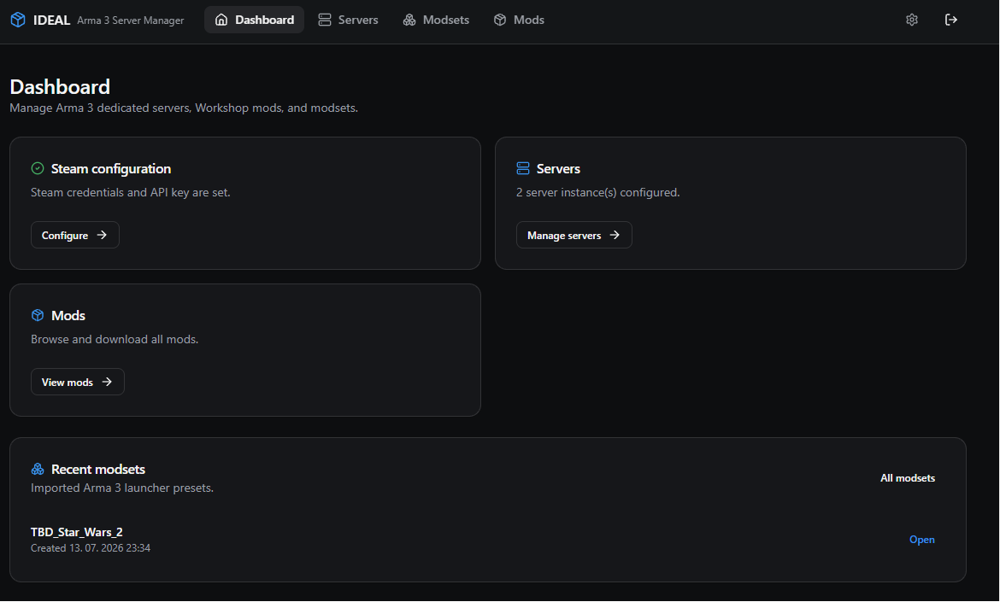

**Settings** — built-in gosteam downloader and Steam login

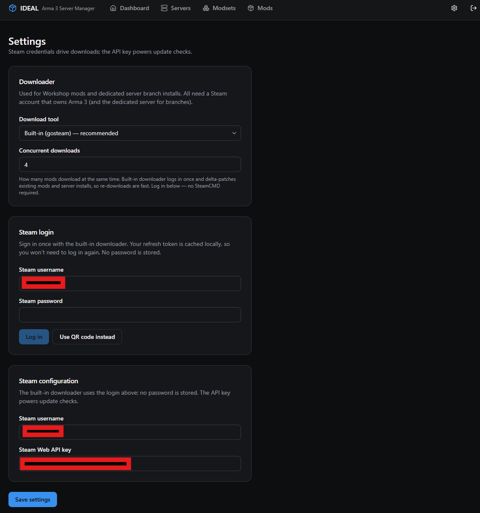

**Branches** — dedicated server installs

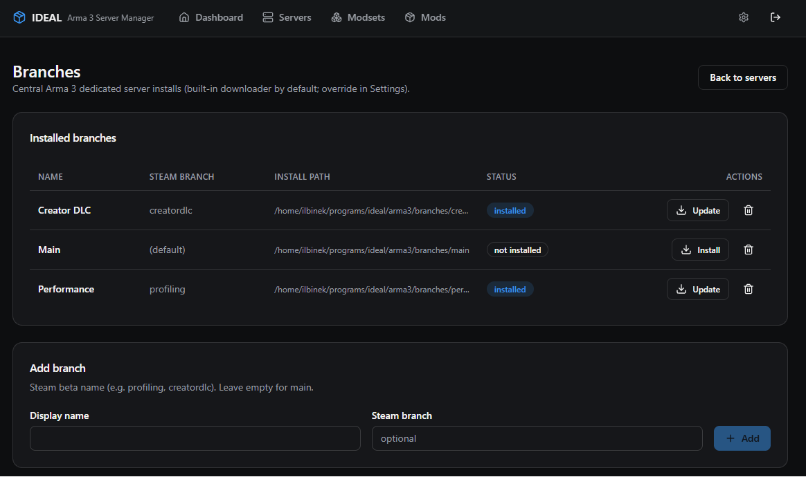

**Modsets** — import Arma 3 Launcher HTML presets

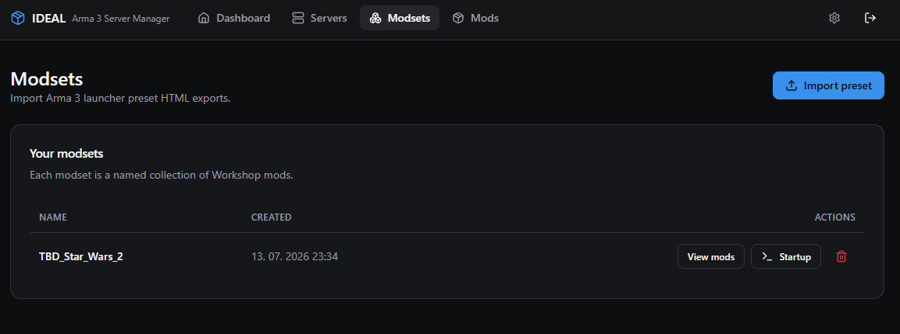

**Mods** — Workshop downloads, updates, and A3Sync generation

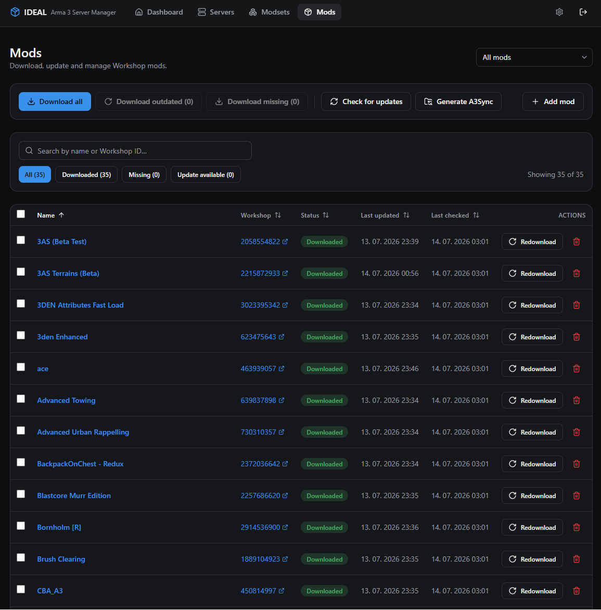

**Servers** — instance list

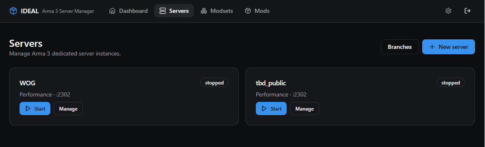

**Server overview** — branch, ports, launch params, command preview


**Server mods** — Workshop / custom mods and provisioning

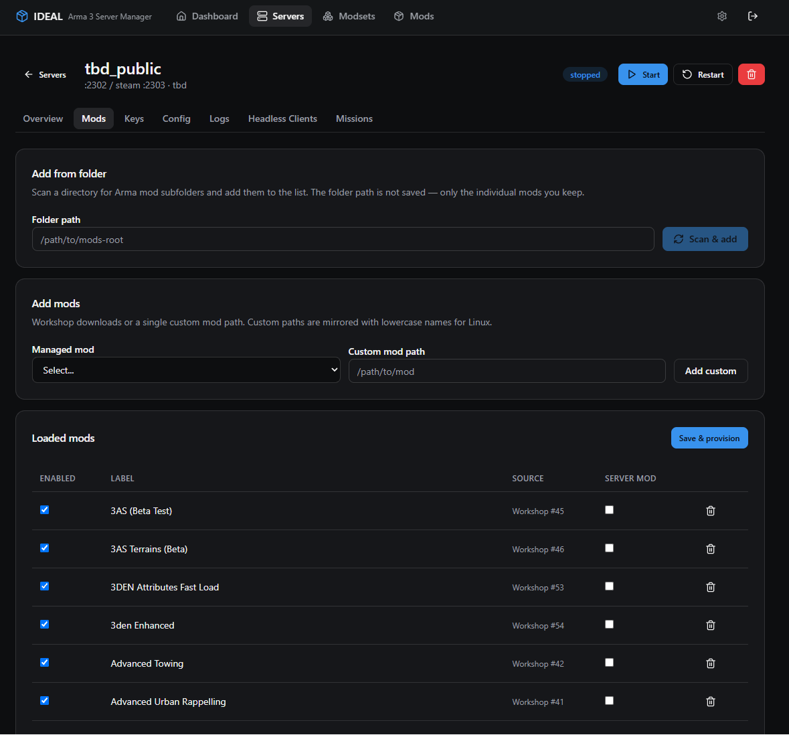

**Server mods (local folders)** — scan a mods root or add custom paths

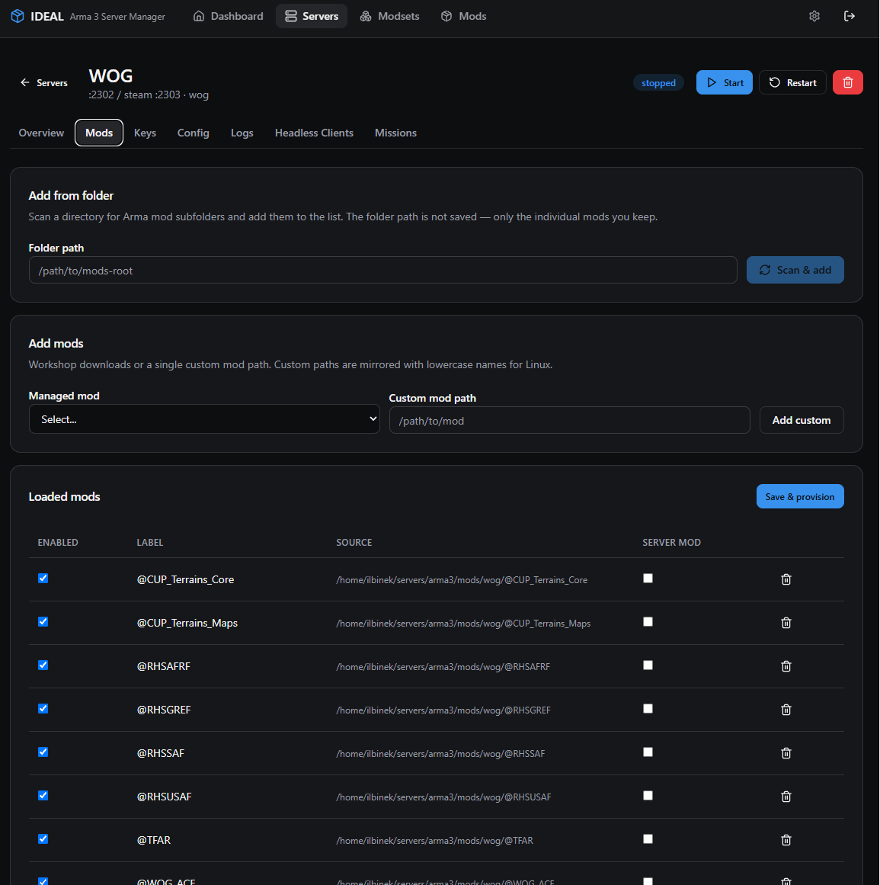

**Keys** — automatic `.bikey` collection

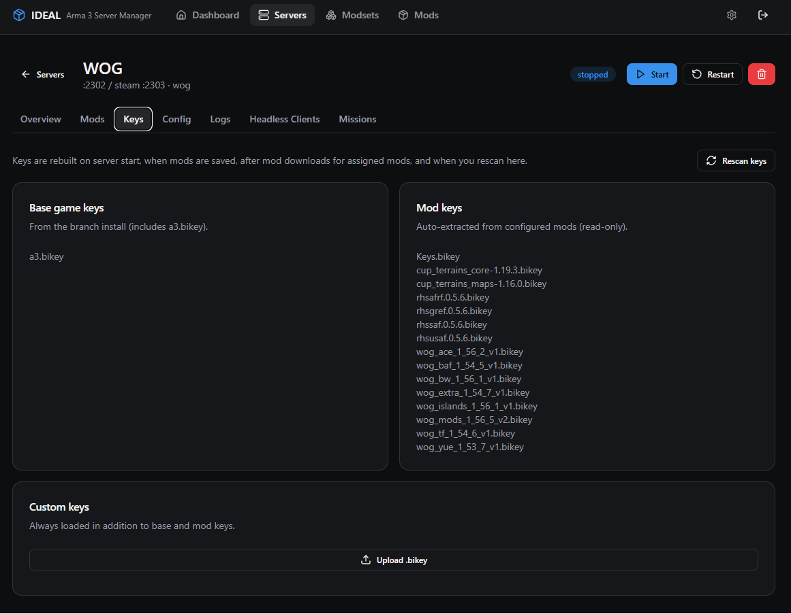

**Config** — simple / raw editors for `server.cfg`, `basic.cfg`, and profile

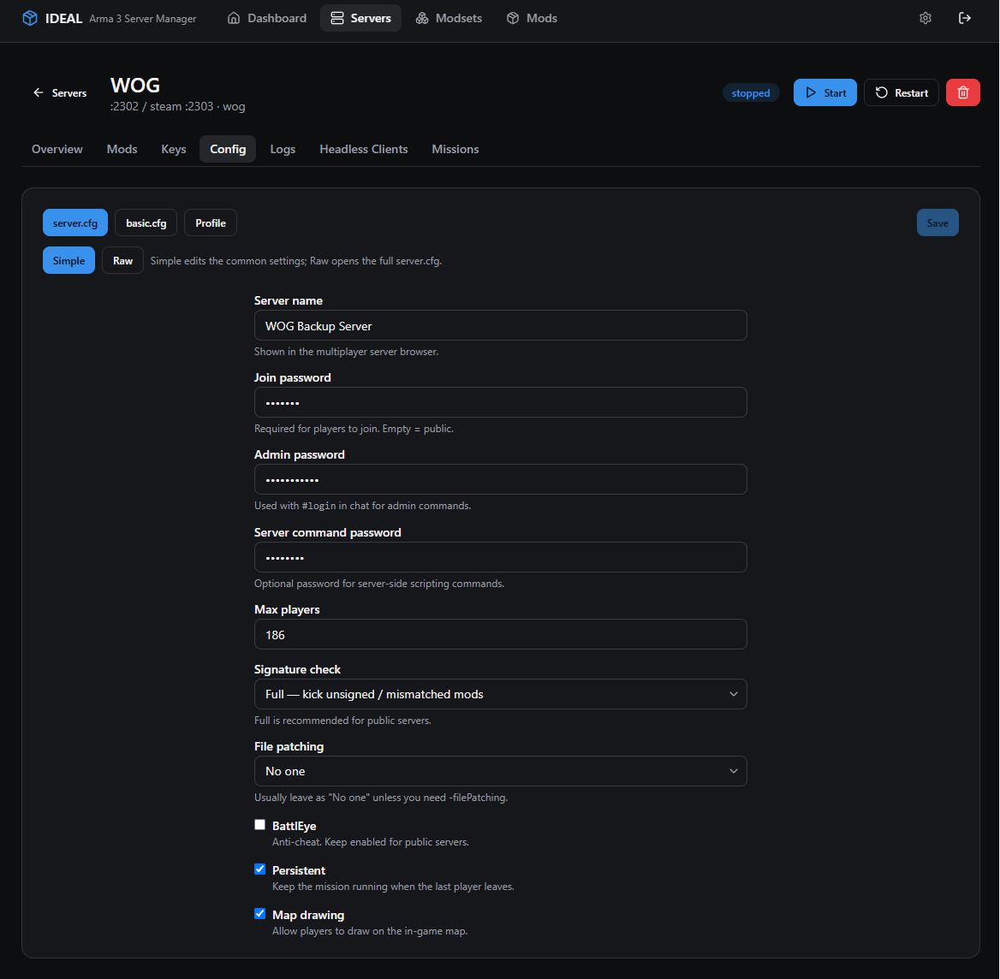

**Headless clients**

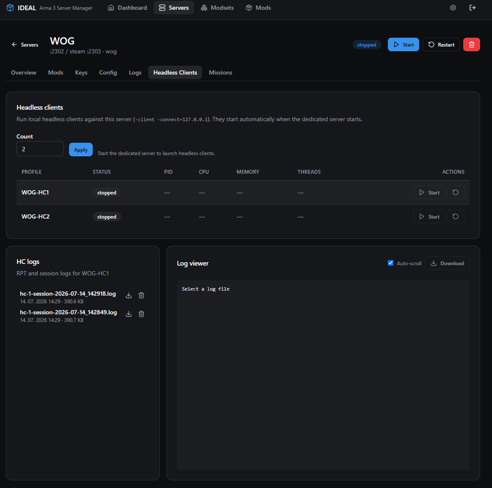

**Missions** — upload and optional HTTP serving

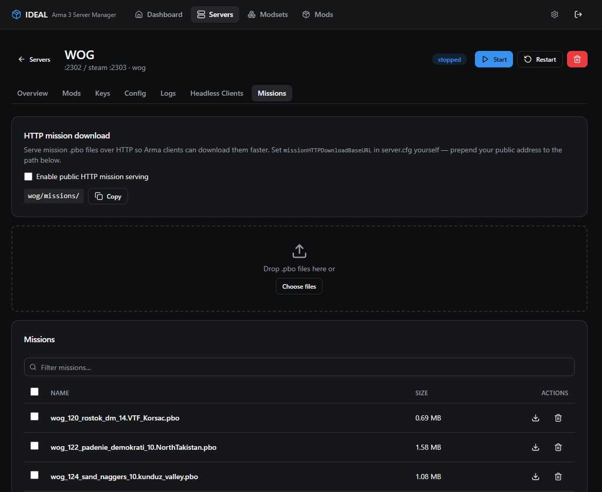

---

## Prerequisites

### Downloader (pick one in Settings)

Used for **Workshop mods** and **dedicated server branch installs** (app `233780`).

| Downloader | Notes |
|---|---|
| **Built-in (gosteam)** — default | No external binary. Log in via Settings (credentials or QR). Supports Steam Guard. Session token stored under `.gosteam/`. Covers mods and server branches — SteamCMD is not required. |
| **DepotDownloader** | [SteamRE/DepotDownloader](https://github.com/SteamRE/DepotDownloader) on `PATH` or an explicit path in Settings. Per-file progress for mods. Branch installs still use SteamCMD when this option is selected. |
| **SteamCMD** | Optional. Coarse progress; workshop items are moved into `./mods/<id>` after download. Also used for branch installs when selected. |

For DepotDownloader / SteamCMD mod downloads, Steam username and password are stored in the SQLite DB (plain text). Prefer a dedicated Steam account. The built-in downloader does **not** require storing a password long-term once logged in.

A Steam Web API key (Settings) is used for update checks.

---

## Installation (release)

1. Download the release for your platform and extract it
2. Edit `config.json` and change `password` from `changeme` (Ideal **refuses to start** until you do)
3. Run the binary:
   ```bash
   # Linux
   ./ideal
   ```
4. Open `http://localhost:8080` (or the port in `config.json`)
5. Log in with the password you set

---

## Configuration

### `config.json`

```json
{
  "password": "changeme",
  "port": "8080"
}
```

Steam credentials, downloader choice, and related options live in the SQLite database and are edited in the **Settings** UI — not in `config.json`.

### Environment variables

| Variable | Purpose |
|---|---|
| `IDEAL_LISTEN` | Override HTTP bind address (e.g. `127.0.0.1:8080`). Default is all interfaces on the configured port (`:8080`). |
| `IDEAL_DATA_DIR` | Override the data root (config, DB, mods, servers, branches). |

---

## Usage

### 1. Install a server branch

1. Open **Branches**
2. Create a branch (name + optional Steam beta branch)
3. Install it — Ideal downloads the dedicated server (app `233780`) with the configured downloader (gosteam by default)

### 2. Create and run a server

1. Open **Servers** → create a server (pick a branch, ports, optional modset)
2. On the server detail page, assign client/server mods, edit config, upload missions as needed
3. Click **Start** — Ideal provisions the instance (`servers/<slug>/`), copies keys, and launches the process
4. Use **Stop** / **Restart** from the UI; live status updates over SSE
5. **Logs** tab tails session output and RPT files

Default ports per server: game `2302`, Steam query `2303` (Steam defaults to game port + 1 if omitted).

After Ideal restarts, transitional statuses are reconciled (e.g. a stuck `stopping` after a reboot becomes `stopped` when the process is gone).

### 3. Mods and modsets

**Modsets:** export an HTML preset from the Arma 3 Launcher → **Modsets** → upload. Mods are added to the database.

**Mods page:**
- Download individual mods or enqueue missing/outdated ones
- Check for updates (needs Steam API key)
- Add a mod by Workshop ID
- Delete mods to free disk space

Downloaded mods live under `./mods/<workshopId>/`. An `./addons/` tree of lowercased symlinks is maintained for server provisioning.

### 4. Keys

For **managed servers**, `.bikey` files are copied into `servers/<slug>/keys/` automatically when the instance is provisioned. You do not need to copy keys by hand for Ideal-started servers.

### 5. A3Sync folder

1. Open **Mods**
2. Click **Generate A3Sync Folder**
3. Ideal creates `./a3sync` with file-level symlinks to downloaded mods

Point your A3Sync repository at that directory.

---

## Directory structure

```
.
├── ideal / ideal.exe     # Main executable (release) or under dist/ when built with Task
├── config.json           # Web UI password + HTTP port
├── arma3mods.db          # SQLite database
├── .gosteam/             # Built-in downloader token/cache
├── mods/                 # Workshop mods (<workshopId>/)
├── addons/               # Lowercased symlink mirrors for provisioning
├── keys/                 # Keys for legacy/manual startup-command flows
├── a3sync/               # Generated A3Sync repository
├── arma3/branches/       # Installed dedicated server branches
├── servers/<slug>/       # Per-server instances (configs, mods, logs, missions)
├── web/                  # React SPA source
├── web/dist/             # Built SPA (embedded via go:embed; not committed)
├── screenshots/          # UI screenshots for this README
└── dist/                 # task build / task run output
```

The SPA is embedded in the binary with `go:embed`, so releases do not ship a separate `web/dist` folder.

---

## Development

Requires [Task](https://taskfile.dev), Go (see `go.mod`), Node.js/npm, and a C compiler (**CGO** is required for SQLite).

```bash
git clone https://gitea.tbdevent.eu/ilbinek/ideal.git
cd ideal
task install
```

### Useful tasks

| Task | Description |
|---|---|
| `task install` | Download Go modules and install frontend deps |
| `task dev` | Run the Go API with `IDEAL_LISTEN=127.0.0.1:8080` |
| `task web:dev` | Vite dev server (proxies `/api` → `:8080`) |
| `task web:build` | Build the SPA into `web/dist` |
| `task build` | Build SPA (if needed) + binary → `dist/ideal` |
| `task run` | Build if sources changed, then run `dist/ideal` |
| `task build:all` | Cross-compile Linux amd64/arm64 into `dist/` |
| `task lint` | `go vet` + frontend typecheck |
| `task clean` | Remove `web/dist` and `dist` |

### Dev workflow (hot-reload UI)

```bash
# Terminal 1 — API
task dev

# Terminal 2 — frontend
task web:dev
```

Open `http://localhost:5173` (Vite). The API listens on `127.0.0.1:8080`.

### Production-like local run

```bash
# Edit config.json password first
task run
```

Opens Ideal with the embedded UI on the port from `config.json` (all interfaces unless `IDEAL_LISTEN` is set).

Do **not** use bare `go build` without building the SPA first — the binary embeds `web/dist`, which is produced by `task web:build` / `task build`.

---

## Troubleshooting

**"Default password is still in use"**  
Change `password` in `config.json` away from `changeme`.

**Downloader / Steam login issues**  
- Built-in: complete Steam login in Settings (Guard/QR supported)  
- DepotDownloader / SteamCMD: ensure the binary is on `PATH` or set the path in Settings  

**Branch install fails**  
- Built-in: log in to Steam from Settings; the account must own / be entitled to the dedicated server  
- SteamCMD / DepotDownloader: SteamCMD must be on `PATH` (or set in Settings); username/password in Settings must be valid

**Server stuck or `unknown` after reboot**  
Ideal reconciles statuses on startup. If a process is gone, status should settle to `stopped` / `unknown`. Use Stop/Start from the UI if needed.

**Empty or broken UI after `go build`**  
Build the frontend first (`task web:build` or `task build`).

**CGO / sqlite build errors**  
Install a C toolchain (e.g. gcc) and ensure `CGO_ENABLED=1`.
